# workstation-clis

[](https://github.com/rodritimecoder/workstation-clis)
[](LICENSE)
[](#-curated-cli-catalog)
[](#-local-hardware--inference-substrate)

> **High-performance local CLI utilities, autonomous agent execution engines, and multimodal inference pipelines designed for dual-GPU AI workstations.**

---

## 🏛️ The Architecture: How The Whole Process Works

This repository houses the runtime tools and execution engines powering an autonomous agent workstation. Rather than relying on cloud APIs, bloated context windows, or corporate framework ceremony, the system is engineered around **four structural pillars**:

```mermaid
flowchart TD
    subgraph L1["1. Constitutional Glue (GEMINI.md / AGENTS.md)"]
        G1["Upstream-First Authority"]
        G2["Mandatory Grounded Verification Protocol<br/>(Launch → Doctor → Drive → Evidence → Cleanup)"]
        G3["No-Comments Discipline & TypeScript Invariant"]
    end

    subgraph L2["2. Execution & Review Engine (DoorDash / craft-hub)"]
        D1["doordash order ponytail (Minimal Diff & YAGNI)"]
        D2["doordash order poteto (State Matrix & Domain Modeling)"]
        D3["doordash order thermonuclear (1000-Line Ceiling & Structural Judo)"]
        D4["doordash order create-verification ([REQ-XX] Traceability Maps)"]
        D5["doordash order unslop (31 AI Tell Filters)"]
    end

    subgraph L3["3. Workspace Pipeline (Interpretable Context Methodology - ICM)"]
        I1["Root AGENTS.md (Routing & Negative Scope Target &lt;60 lines)"]
        I2["Stage CONTEXT.md (Explicit Input / Process / Output Contracts)"]
        I3["Filesystem as State Machine (COMPLETE vs STALE via Timestamps)"]
    end

    subgraph L4["4. Grounded Memory & Continuity (graph-memory)"]
        M1["Local BGE-Small-en-v1.5 384d Embeddings (:8082)"]
        M2["SQLite FTS5 BM25 Keyword Search"]
        M3["Reciprocal Rank Fusion (K=60)"]
        M4["Verbatim Exact-Quote LLM Distillation (:8000 Qwen3.6-35B)"]
    end

    subgraph HW["Local Hardware Substrate (Dual AMD Radeon RX 9060 XT - 32GB VRAM)"]
        P1[":8000 llama-swap / :4000 LiteLLM"]
        P2[":8080 Qwen3.6-35B ROCMFP4"]
        P3[":8081 audio.cpp Nemotron ASR"]
        P4[":8082 BGE-Small-v1.5 Embeddings"]
        P5[":8085 LightOnOCR-3-1B Flagship"]
        P6[":8083 Imajev-4B Decision"]
    end

    HW --> L1
    L1 --> L2
    L2 --> L3
    L3 --> L4
```



---

## 🔬 The Grounded Verification Protocol ("Prove It Works")

The primary machine invariant across all CLI tasks is the **5-step Grounded Verification Loop**:
1. **Launch**: Start the real local service, daemon, or CLI environment from a clean state.
2. **Doctor**: Run a read-only health check (*"is this instance worth driving?"*) before attempting user flows.
3. **Drive**: Exercise the real user journey programmatically (via PTY, curl, or containerized CDP browser).
4. **Evidence**: Capture observable proof (exit codes, terminal transcripts, response bodies, screenshots) that survives process teardown.
5. **Cleanup**: Terminate child processes cleanly without stranding ports or orphan background workers.

### Upgraded Engineering Disciplines
- **Pre-Implementation State Transition Matrix**: Before writing multi-step async or UI logic, agents must tabulate `Current State × Event → Next State + Rollback` (enforced via `poteto` and `typescript` kitchens).
- **Numbered Requirement Traceability (`[REQ-XX]`)**: Every acceptance criterion carries a `[REQ-XX]` tag linked directly to verification feature maps (`features/<feature>.md`) and PR planning blocks in `check-plan.mjs`.

---

## ⚡ Local Hardware & Inference Substrate

All models run 100% locally on dual AMD Radeon RX 9060 XT GPUs via ROCm and Vulkan backends:

| Port | Model / Service | Role & Performance |
|---|---|---|
| `:8000` | **llama-swap** | Model hot-swapper with dynamic concurrency sets ($\le$ 32GB resident) |
| `:4000` | **LiteLLM Proxy** | OpenAI-compatible proxy with dynamic VRAM balancing and failover |
| `:8080` | **Qwen3.6-35B-A3B Uncensored Genesis** | Primary Workstation LLM (22 GB ROCMFP4, dual-GPU `-ts 45/55`) |
| `:8081` | **audio.cpp (Nemotron 3.5 + Kokoro)** | Streaming speech-to-text (40 languages) & fast text-to-speech |
| `:8082` | **bge-small-en-v1.5 (F16 GGUF)** | Dedicated 384-dimensional symmetric vector embeddings |
| `:8083` | **Imajev-4B ($T=1.305$)** | Calibrated multimodal decision gating (vision + text) |
| `:8084` | **CrispEmbed Suite** | Ultra-compact scene-text detection & line recognition (DBNet + PARSeq) |
| `:8085` | **LightOnOCR-3-1B** | **#1 Flagship Video & Slide OCR** (~16k t/s prefill, ~330 t/s gen) |
| `:8088` | **DeskForge-Qwen3.5-4B** | Visual GUI grounding & computer-use coordinate extraction |
| `:8090` | **JPT-4B Decision Engine** | System One decision gating with multimodal vision projector |

---

## 📦 Curated CLI Catalog

This suite contains 12 focused engineering, sandbox, and inference CLIs:

| Tool Directory | Identifier | Core Capabilities |
| :--- | :--- | :--- |
| [`craft-hub`](craft-hub/) | `craft-hub` / `doordash` | Late-binding DoorDash API for code craft & review: Ponytail, pstack (23 playbooks), Poteto Mode, Thermonuclear, Unslop, and Grounded Verification. |
| [`subagent-spaces`](subagent-spaces/) | `subagent-spaces` | CPU-pinned rootless Podman sandboxes partitioning 16 CPU threads into dedicated worker slots with zero host blast radius. |
| [`skills-hub`](skills-hub/) | `skills-hub` | Unified meta-tool discovery and execution layer for workstation skills with zero context bloat. |
| [`graph-memory`](graph-memory/) | `graph-memory` | Local hybrid RAG (BM25 + BGE-small 384d) with exact-quote LLM distillation, prompt recall hooks, and session digests. |
| [`litellm-vram-switcher`](litellm-vram-switcher/) | `vram-rig-ctl` | Multi-GPU VRAM switcher, llama-swap orchestrator (:8000), and LiteLLM failover manager (:4000). |
| [`tailscale-ops`](tailscale-ops/) | `tailscale-ops` | Tailscale mesh networking, homelab node discovery, HTTPS serving, and peer file transfer. |
| [`ocr-cli`](ocr-cli/) | `ocr-cli` | Multi-model local OCR engine uniting LightOnOCR-3-1B (#1 flagship), SmolDocling, and CrispEmbed. |
| [`hybrid-browser`](hybrid-browser/) | `hybrid-browser` | Tiered browser automation agent using Podman Chromium, CDP, and DeskForge-Qwen3.5-4B visual grounding. |
| [`video-miner`](video-miner/) | `video-miner` | 6-stage ICM video mining orchestrator combining Nemotron ASR, Imajev visual gating, and LightOnOCR code extraction. |
| [`audiocpp-asr`](audiocpp-asr/) | `audiocpp-asr` | Local speech-to-text with Nemotron-3.5 streaming RNNT, hotword prompting, and live mic dictation. |
| [`jev-cli`](jev-cli/) | `jev-cli` | Calibrated decision model CLI querying Imajev-4B and JPT-4B for probabilities, classifications, and gating. |
| [`markitdown-cli`](markitdown-cli/) | `markitdown-cli` | Universal document converter to Markdown (PDF, DOCX, XLSX, PPTX, CSV, HTML, Audio). |

---

## 🚀 Tool Highlights

### 1. `craft-hub` / `doordash` — On-Demand Code Craft & Review Hub
Enforce elite engineering rubrics on any codebase without bloating prompt context:
```bash
# View available kitchens
doordash menu

# Order specific audit or review pass
doordash order ponytail [target]              # Minimal diff & YAGNI audit
doordash order poteto [target]                # Domain modeling & State Transition Matrix
doordash order thermonuclear [target]         # 1,000-line ceiling & structural judo
doordash order create-verification [target]   # Generate [REQ-XX] Grounded Verification harness
doordash order unslop [target]                # 31-rule AI tell scanner

# Run full combo review
doordash order combo [target]
```

### 2. `graph-memory` — Local Hybrid RAG & Exact-Quote Distillation
Zero-dependency local memory system combining keyword and semantic meaning:
```bash
# Search notes or docs using hybrid reciprocal rank fusion (K=60)
python3 graph-memory/rag/search.py "conductance matrix in nodal analysis"

# Rebuild vector index via local bge-small endpoint (:8082)
python3 graph-memory/rag/build_index.py --corpus "/path/to/notes"

# Distill notes into verified question-quote triplets via Qwen3.6-35B (:8000)
python3 graph-memory/rag/distil.py "/path/to/notes" --limit 10
```

### 3. `ocr-cli` — High-Throughput Local Vision OCR
Unifies local vision models without cloud latency or subscription costs:
```bash
# Auto-detects running server (defaults to LightOnOCR on :8085)
python3 ocr-cli/scripts/ocr.py slide_frame.png -o slide_frame.md

# Target specific local engine
python3 ocr-cli/scripts/ocr.py document.pdf --engine lighton
python3 ocr-cli/scripts/ocr.py storefront.png --engine crispembed
```

### 4. `hybrid-browser` — Vision-Grounded Browser Agent
Automates complex web interactions using Chrome DevTools Protocol (CDP) inside rootless Podman containers, with DeskForge-Qwen3.5-4B visual fallback for Canvas/SVG elements:
```bash
python3 hybrid-browser/scripts/hybrid_browser.py "https://news.ycombinator.com" --action "read_headlines"
```

---

## 🔗 Related Repositories

- **[`academic-agent-skills`](https://github.com/rodritimecoder/academic-agent-skills)**: Academic pipeline repository containing Canvas LMS synchronization (`canvas-cli`), cloud Zoom recording extraction (`zoom-recorder`), Cornell active-recall notes (`cornell-notes`), and Open Knowledge Format bundles (`okf-architect`).
- **[`my-agent-skills`](https://github.com/rodritimecoder/my-agent-skills)**: Canonical upstream private repository synchronizing 25+ agent skills across local harnesses (`sync-skills`).
