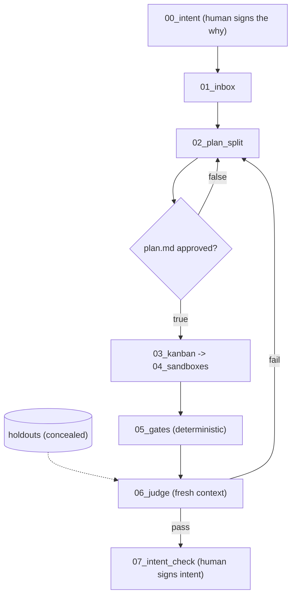

# AGENTS.md — {Workspace Name} (Autonomous Software Factory)

**Workspace Form**: Kem Glitch's six-phase development loop (Reel `DemLMidtxxj`) in ICM form, built on the seven-step factory (Reel `DehIT3lNgHC`)
**Methodology**: Interpretable Context Methodology (ICM; arXiv:2603.16021) + Graph-Memory

## Where the human owns the loop

Both human gates are files, not conversation:

- `00_intent/output/why.md` — why this exists and what it will not do. Signed once.
- `02_plan_split/output/plan.md` — starts `approved: false`; `03_kanban` will not move a card while it is false.
- `07_intent_check/output/intent_check.md` — a verdict per non-goal in `why.md`. Nothing merges before it exists.

## Hierarchy & Control Map
| Layer | Directory / File | Role & Invariants |
|---|---|---|
| **L0** | `AGENTS.md` | Factory routing, core invariants, and memory queries |
| **L1** | `CONTEXT.md` | Six-phase sequence and status progression |
| **L2** | `00_intent/` | Human-signed why / why-not, the constitution every run is checked against |
| **L2** | `01_inbox/` | Ingests feature requests into `output/feature_spec.md` |
| **L2** | `02_plan_split/` | Vertical slices, upfront holdouts, `output/plan.md` awaiting approval |
| **L2** | `03_kanban/` | Physical Kanban state: `todo/`, `doing/`, `done/`, `rejected/` |
| **L2** | `04_sandboxes/` | Isolated worker slots (uses `worktree-harness` + `claims.json`) |
| **L2** | `05_gates/` | Deterministic verification: `pytest`, `cargo test`, `playwright-rs` |
| **L2** | `06_judge/` | Fresh-context judge: audits code against spec without seeing builder scratchpad |
| — | `holdouts/` | Concealed acceptance tests: outside the sequence, read only by `06_judge` |
| **L2** | `07_intent_check/` | Final human gate: verdict per non-goal, evidence a person can read |
| **L3** | `_shared/rules.md` | Immutable engineering invariants |
| **L3** | `_shared/kem-contract.md` | The five moves and the three stage-contract fields |

## Stage Contract
Every stage names who does it (`**Actor:**`), how (`**Step type:**` D/P/H), and what proves it ran (`**Proof:**`). A stage that cannot name its proof is a note, not a stage. Fail on gaps: `icm-architect validate . --kem`.

## Memory & Blast Radius Queries
Before editing across stages, query the entity graph: `python3 _memory/memory.py k-hop <EntityName> --hops 2` for downstream dependencies, `python3 _memory/memory.py search "query"` for specs and docs.

## Stage Pipeline
- [00_intent](00_intent/CONTEXT.md): The signed why and why-not.
- [01_inbox](01_inbox/CONTEXT.md): Ingest raw requirements, user stories, and bug prompts into a feature spec.
- [02_plan_split](02_plan_split/CONTEXT.md): Decompose work into vertical slices, generate holdout tests, emit the plan for approval.
- [03_kanban](03_kanban/CONTEXT.md): Target-local markdown Kanban board state machine (todo, doing, done, rejected).
- [04_sandboxes](04_sandboxes/CONTEXT.md): Parallel builder worker slots running in isolated git worktrees.
- [05_gates](05_gates/CONTEXT.md): Deterministic quality test gates (unit tests, clippy, playwright-rs).
- [06_judge](06_judge/CONTEXT.md): Fresh-context unbiased evaluation audit logs evaluating against spec.
- [07_intent_check](07_intent_check/CONTEXT.md): Human verdict against the original why and why-not.
- [holdouts](holdouts/CONTEXT.md): Concealed acceptance tests, read only by `06_judge`.
