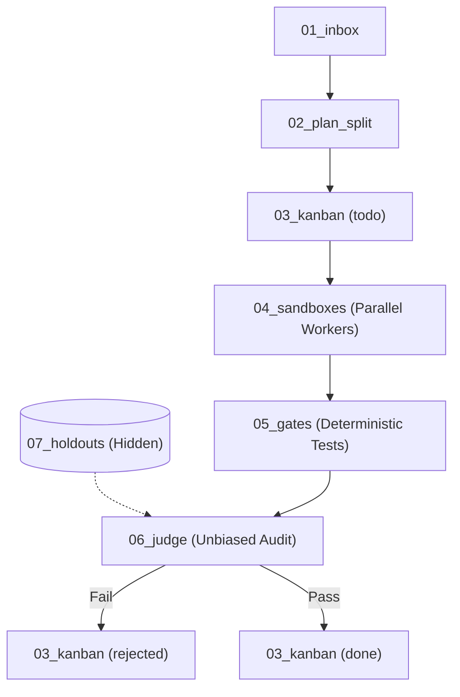

# AGENTS.md — {Workspace Name} (Autonomous Software Factory)

**Workspace Form**: Agentic Software Factory (Kem Glitch 7-Step Architecture; Reel `DehIT3lNgHC`)
**Methodology**: Interpretable Context Methodology (ICM; arXiv:2603.16021) + Graph-Memory



## Hierarchy & Control Map
| Layer | Directory / File | Role & Invariants |
|---|---|---|
| **L0** | `AGENTS.md` | Factory routing, core invariants, and memory queries |
| **L1** | `CONTEXT.md` | 7-step sequence and status progression |
| **L2** | `01_inbox/` | Ingests feature requests into `output/feature_spec.md` |
| **L2** | `02_plan_split/` | Task splitter, vertical slices, upfront holdout generation |
| **L2** | `03_kanban/` | Physical Kanban state: `todo/`, `doing/`, `done/`, `rejected/` |
| **L2** | `04_sandboxes/` | Isolated worker slots (uses `worktree-harness` + `claims.json`) |
| **L2** | `05_gates/` | Deterministic verification: `pytest`, `cargo test`, `playwright-rs` |
| **L2** | `06_judge/` | Fresh-context judge: audits code against spec without seeing builder scratchpad |
| **L2** | `07_holdouts/` | Hidden tests: builder agents never see this folder |
| **L3** | `_shared/rules.md` | Immutable engineering invariants |
| **L3** | `_memory/` | Dual-legged graph memory (`graph.db`) & hybrid RRF search (`memory.py`) |

## Memory & Blast Radius Queries
Before modifying code across stages, query the local entity graph:
```bash
# Query downstream dependencies in <2ms:
python3 _memory/memory.py k-hop <EntityName> --hops 2

# Query semantic specs and docs:
python3 _memory/memory.py search "query string"
```

## Stage Pipeline
- [01_inbox](01_inbox/CONTEXT.md): Ingest raw requirements, user stories, and bug prompts into a feature spec.
- [02_plan_split](02_plan_split/CONTEXT.md): Decompose work into vertical slices and generate holdout tests.
- [03_kanban](03_kanban/CONTEXT.md): Target-local markdown Kanban board state machine (todo, doing, done, rejected).
- [04_sandboxes](04_sandboxes/CONTEXT.md): Parallel builder worker slots running in isolated git worktrees.
- [05_gates](05_gates/CONTEXT.md): Deterministic quality test gates (unit tests, clippy, playwright-rs).
- [06_judge](06_judge/CONTEXT.md): Fresh-context unbiased evaluation audit logs evaluating against spec.
- [07_holdouts](07_holdouts/CONTEXT.md): Anti-sycophancy holdout test suite hidden from builder agents.
