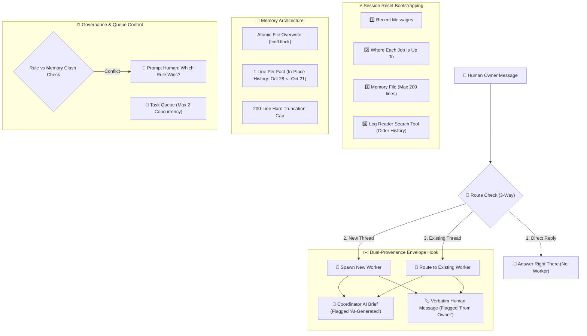

# Projects Harness — Multi-Agent Coordination CLI (`projects-harness`)

A pure-CLI multi-agent orchestration harness reverse-engineered directly from Anthropic's **Claude Projects in Claude Code** ("core code") by **Kem Glitch (Glitch Cat Club)** in Reel [`DejvUBotWJD`](https://www.instagram.com/reel/DejvUBotWJD/).

---

## 🏛️ Architecture Overview



---

## 🔑 The 8 Core Components

1. **`THE LOG`**: Append-only ledger of every message (`messages.jsonl`).
2. **`START-UP HOOK`**: Fresh context bootstrapping. Injects only (1) recent messages, (2) current job states, and (3) memory ledger.
3. **`LOG READER`**: Late-binding search tool. Older history is queried on-demand instead of bloated into context.
4. **`ROUTE CHECK`**: Deterministic 3-way routing: (a) answer directly, (b) spawn worker thread, or (c) route to active worker.
5. **`ENVELOPE HOOK`**: Dual-provenance envelope isolating synthetic coordinator brief from verbatim human boss constraints.
6. **`MEMORY WRITER`**: Atomic file rewrite, 1 line per fact, in-place update history (`Oct 28 <- Oct 21 <- Oct 14`).
7. **`CLASH CHECK`**: Conflict arbiter detecting contradictions between human instructions and dynamic memory writes.
8. **`QUEUE LIMITER`**: Concurrency throttler (`max 2 at once`) managing `WORKING`, `QUEUED`, and `DONE` states.

---

## 🧱 Kem's 4-Quadrant Implementation Rubric

| Quadrant | Invariant | CLI Implementation |
| :--- | :--- | :--- |
| **⚡ A Hook** | *"If it always has to happen"* | Envelope provenance wrap, pre-execution reports, clash halts |
| **🔒 Script-Only File** | *"State that only code can mutate"* | Memory file (`memory.txt`), task queue (`task_queue.json`) |
| **📖 A Skill** | *"Standard operational procedures"* | Output formatting schemas, tool definitions |
| **📜 CLAUDE.md / Rules** | *"Human rules & judgment rubrics"* | Routing priorities, persona, style constraints |

---

## 🛠️ CLI Usage

```bash
CLI="python3 /run/media/rodri/AI/skills/projects-harness/projects_harness.py"

# 1. Bootstrap session on restart (recent msgs + job status + memory <= 200 lines)
$CLI startup

# 2. 3-Way message routing check
$CLI route "How does OAuth work in our backend?"
# -> Direct Reply

$CLI route "Build an authentication endpoint with JWT"
# -> Spawn new worker thread

# 3. Format dual-provenance envelope for subagent
$CLI envelope --brief "Extract JWT claims and validate expiry" --owner "Ensure token expiration is 15 minutes"

# 4. Atomic memory update with history tracking
$CLI memory update "Launch date" "Oct 28"

# 5. Check queue status (max 2 concurrency)
$CLI queue status

# 6. Search historical log on-demand
$CLI log search "JWT"
```

---

## 🧪 Grounded Verification Suite

Run Kem's 7-stage test suite:
```bash
python3 /run/media/rodri/AI/skills/projects-harness/tests/test_projects_harness.py
```
Output:
```
✓ handoff · 3/3
✓ report · forced by a hook
✓ memory · one line, history kept
✓ parallel saves · 20/20
✓ cap · 200 of 210 lines
✓ clash · raised and asked
✓ queue · max 2, 9/9 queued starts
```
